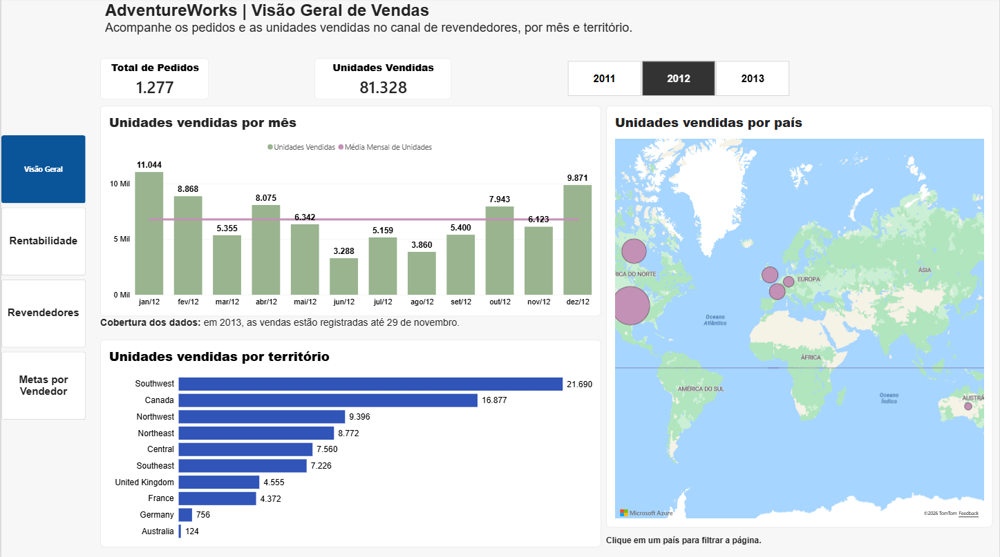

# AdventureWorks | Análise comercial no Power BI

Projeto de portfólio de **Liliane Rose Refatti** sobre vendas no canal de revendedores da AdventureWorks. O relatório reúne volume de vendas, rentabilidade, concentração por revendedor e acompanhamento de metas trimestrais.

**[Explorar o relatório interativo no Power BI](https://app.powerbi.com/view?r=eyJrIjoiMmU5ZDllYmItMmJlOS00ZjIzLTg4OGMtMmRhNWMwNzAzZjhiIiwidCI6IjYwMjcxMGYzLTAyNGYtNGQ2YS1hZDQ4LTM3OTkwZTU4MzUwMCJ9)** · Acesso sem login.

## Perguntas de negócio

| Página | Pergunta que responde |
| --- | --- |
| Visão Geral | Como as unidades vendidas se distribuem por mês, território e país? |
| Rentabilidade | Quais categorias e modelos mais pesam no resultado bruto? |
| Detalhe do Modelo | Como os descontos afetam o resultado bruto das variantes de um modelo? |
| Revendedores | Quanto os cinco maiores representam do volume e como volume e margem variam entre revendedores? |
| Metas por Vendedor | Quanto cada vendedor atingiu da meta trimestral e quais metas precisam de revisão? |

## Principais achados

- **Volume e rentabilidade podem contar histórias diferentes.** No recorte disponível de 2013, o canal registrou 103.658 unidades e resultado bruto de −491.870,01, com margem de −1,46%. A categoria Bikes teve resultado bruto de −1.016.621,66.
- **O detalhamento mostra o efeito dos descontos na medida de resultado.** No mesmo recorte, o Touring-1000 já apresentava resultado bruto de −557.508,04 antes dos descontos. Com 129.677,67 em descontos registrados, o resultado foi de −687.185,71.
- **O ranking ajuda a medir concentração.** Em 2012, os cinco maiores revendedores por volume responderam por 6.134 de 81.328 unidades, ou 7,54%.
- **Meta ausente ou com múltiplos registros exige tratamento próprio.** Para Michael Blythe, o 2º trimestre de 2012 atingiu 122,20% da meta, com 161.813,12 acima do previsto. Em 2011, o 2º trimestre estava sem meta e o 3º tinha mais de um registro. As vendas aparecem em ambos, enquanto atingimento e diferença ficam em branco.

## Dados, modelagem e validação

- **Fonte:** [AdventureWorksDW, base de exemplo da Microsoft](https://github.com/microsoft/sql-server-samples/tree/master/samples/databases/adventure-works). Os arquivos do pacote de instalação do data warehouse foram importados no Power Query.
- **Modelo:** esquema estrela com duas tabelas fato, `FactResellerSales` e `FactSalesQuota`, e dimensões para data, produto, território, vendedor, revendedor, moeda e promoção.
- **Medidas DAX:** pedidos distintos, unidades vendidas, valor de vendas, custo dos produtos, resultado bruto, margem bruta, participação do Top 5 e atingimento trimestral. O resultado bruto é calculado como valor de vendas menos custo dos produtos.
- **Validação:** conferência de chaves e relacionamentos, comparação de totais por ano e contagem de registros de meta por vendedor, ano e trimestre. O relatório inclui uma página técnica de validação.
- **Navegação:** menu lateral, filtros por ano e vendedor e navegação de Rentabilidade para Detalhe do Modelo por drill-through.

## Como explorar

Abra o relatório pelo link público acima. Se tiver o arquivo `.pbix`, também pode explorá-lo no Power BI Desktop.

1. Comece pela Visão Geral de 2012. Clique em um país no mapa para explorar o recorte geográfico.
2. Em Rentabilidade, selecione 2013 e o modelo **Touring-1000**. Use o botão **Ver detalhes do modelo** para comparar as variantes antes e depois dos descontos. No modo de edição do Desktop, use **Ctrl + clique** no botão.
3. Em Metas por Vendedor, selecione **Michael Blythe (281)** e alterne entre 2012 e 2011 para comparar metas válidas com os casos sem meta ou com registros a revisar.

Para atualizar os dados em outro computador, extraia os arquivos da fonte original e ajuste os caminhos de origem no Power Query antes de atualizar.

## Limites da análise

As vendas de 2013 estão registradas até **29 de novembro**. Os totais desse recorte devem ser lidos como valores do período disponível. Os valores monetários seguem a escala da base original, sem conversão para reais. O resultado bruto mede vendas menos custo dos produtos; ele não representa lucro líquido nem estima como a demanda mudaria sem descontos.

<!-- Depois da publicação do vídeo, acrescente aqui um link para a demonstração. -->
